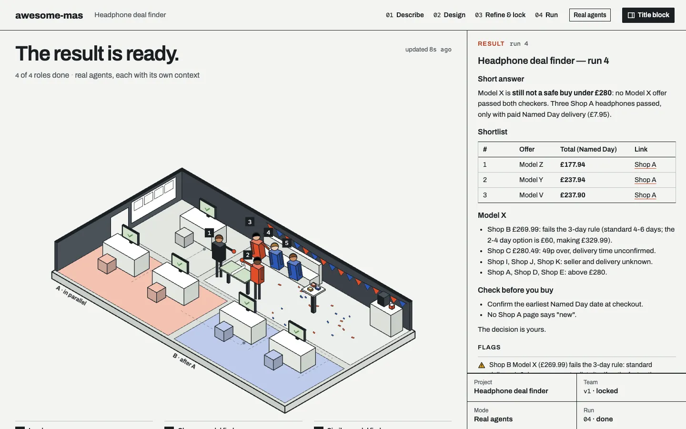
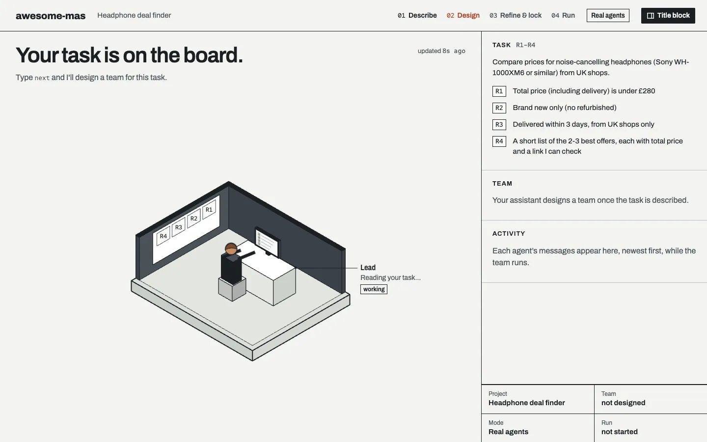
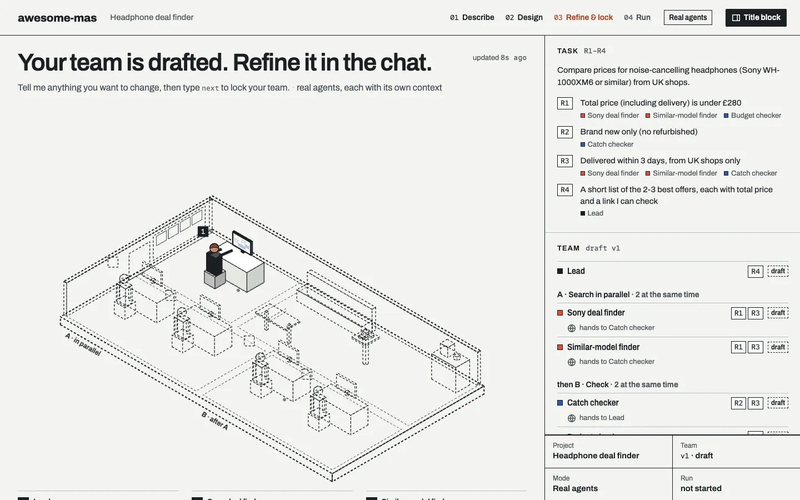
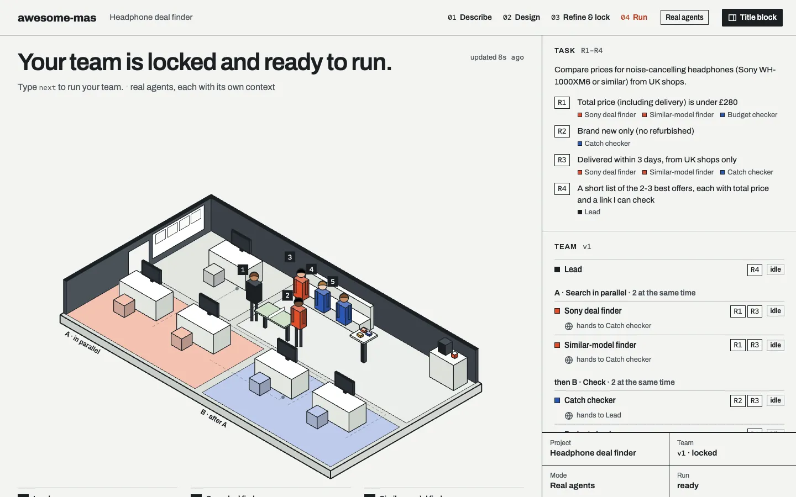
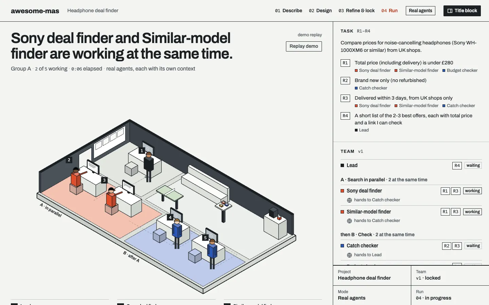
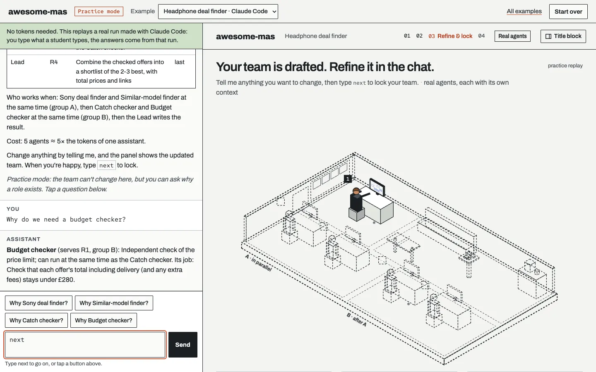

<div align="center">

# awesome-mas

### Build your own team of AI agents, step by step.

Pick a task you really care about. Your AI assistant designs a small team of agents for it,<br>
you shape the team by chatting, and you watch the agents work together in a live office.

[](#-part-a--set-up-your-folder-once)
[](#-part-a--set-up-your-folder-once)
[](#-part-a--set-up-your-folder-once)
[](#-before-you-start)
[](#-part-a--set-up-your-folder-once)
[](LICENSE)

[**📖 Step-by-step tutorial**](https://www.xijiawei.com/awesome-mas/) · [**Set up**](#-part-a--set-up-your-folder-once) · [**The 4 steps**](#-the-whole-journey) · [**Practice mode (no tokens)**](#-practice-mode-every-step-without-tokens) · [**Troubleshooting**](#-if-something-goes-wrong) · [**For developers: MAS Office**](https://github.com/weixijia/mas-office)



<sub>Where you will end: your team in the office, and the answer to your task on the right. A real run from the price-comparison example, with product and shop names replaced by placeholders.</sub>

</div>

---

A chat window answers one question at a time and forgets when you close it. **awesome-mas turns the AI tool you already use into the Lead of your own small team of agents**: it writes your task down, proposes who should do what, lets you decide, and then runs the team while an animated office shows every agent at work. Everything happens in plain files in one folder. The [tutorial](https://www.xijiawei.com/awesome-mas/) walks you through every message you type, with a picture of each step; this README has the same steps.

| | |
|---|---|
| 🧑‍💻 **You need** | An AI coding assistant. This guide uses the **Antigravity CLI** (`agy`), with a personal Google account; Claude, Codex and others work too |
| ⏱️ **Time** | About 60–90 min the first time |
| ✍️ **Coding** | None. You only chat |
| 🎓 **No tokens?** | [Practice mode](#-practice-mode-every-step-without-tokens) does every step with a real example, for free |

## 🧭 The whole journey

Set up once, then 4 steps. **You type `next` 4 times in all: once for each step.**

| | You type | You get | Time |
|---|---|---|---|
| **[Part A · Set up](#-part-a--set-up-your-folder-once)** (once per folder) | one sentence | your folder ready, the live panel open | 5–10 min |
| **[Step 1 · Describe](#step-1--describe-your-task)** | `next`, then 5 answers | your requirements R1, R2… and a folder named after your task | 10–15 min |
| **[Step 2 · Design](#step-2--let-it-design-a-team)** | `next` | a draft team for your requirements | 2 min, then read |
| **[Step 3 · Refine & lock](#step-3--refine-the-team-then-lock-it)** | changes in your own words, then `next` | one job file per agent | 10–20 min |
| **[Step 4 · Run](#step-4--run-it-and-watch)** | `next`, then wait | a result with sources you can open | 3–8 min |
| **[After](#-after-the-run)** | `run again`, `unlock`, `new` | another run, a changed team, another MAS | — |

> **Five questions is not five steps.** The five questions are all inside step 1. Your assistant asks them one at a time, and step 1 is done when it shows you your requirements.

## ✅ Before you start

1. **An AI coding assistant, signed in.** This guide uses the **Antigravity CLI** (`agy`): it runs in a terminal and you sign in with a personal Google account (Free, Pro or Ultra). Claude (the desktop app or Claude Code), Codex (the app or the CLI), the Antigravity IDE or a similar assistant that can read and write files in a folder work the same way; pick your tool in A1. Your normal chat website is not enough: it cannot keep files.
2. **A task you genuinely want help with.** Comparing prices before a purchase, planning a trip, checking whether a thesis idea is feasible, finding a flat, planning meals, preparing job applications. Anything works, as long as you can say what a good answer looks like.
3. **A browser for the live panel.** Any modern browser. There is nothing to click or connect in it; it only shows what your team is doing.

A full run uses a real share of your plan's usage, because every agent reads and writes on its own; a free plan's quota can run out after a few runs (in the Antigravity CLI, type `/usage` to see what is left). Keep your first team small: a Lead plus 2–4 agents. If your usage runs out, or you have none, you can still do every step in [practice mode](#-practice-mode-every-step-without-tokens).

## 🚀 Part A · Set up your folder (once)

> **You paste** one line (or one sentence) · **Time** about 5–10 min · **You approve** nothing, with a CLI line · **Ends with** “Type `next`…”

One folder can later hold several MAS, so you set it up only once. Everything your team writes stays in this folder, as plain files you can open.

### A1 · Start your AI tool with one line

This guide uses the Antigravity CLI. With a terminal tool (Antigravity CLI, Claude Code, Codex CLI) **one pasted line does everything**: it installs what is missing, makes the folder, starts your assistant in it and hands it the setup sentence. Using an app? Open its section.

<details open>
<summary><b>Antigravity CLI</b> (terminal) — used in this guide</summary>

1. **Open a terminal.** macOS: press Cmd+Space, type `Terminal`, press Enter. Windows: open the Start menu, type `PowerShell`, press Enter.
2. **Copy the line for your computer, paste it into the terminal (not into an Antigravity chat that is already open) and press Enter.** It installs the Antigravity CLI (if you don't have it yet), makes a folder `my-mas` on your Desktop, starts Antigravity there and gives it the setup sentence:
   - macOS:
     ```bash
     curl -fsSL https://antigravity.google/cli/install.sh | bash && export PATH="$HOME/.local/bin:$PATH" && mkdir -p ~/Desktop/my-mas && cd ~/Desktop/my-mas && agy --dangerously-skip-permissions -i "Set up awesome-mas here: read https://raw.githubusercontent.com/weixijia/awesome-mas/main/SETUP.md and follow it."
     ```
   - Windows (PowerShell):
     ```powershell
     irm https://antigravity.google/cli/install.ps1 | iex; $env:Path += ";$env:LOCALAPPDATA\agy\bin"; $d = Join-Path ([Environment]::GetFolderPath('Desktop')) 'my-mas'; New-Item -ItemType Directory -Force $d | Out-Null; Set-Location $d; agy --dangerously-skip-permissions -i "Set up awesome-mas here: read https://raw.githubusercontent.com/weixijia/awesome-mas/main/SETUP.md and follow it."
     ```
3. **The first time** Antigravity asks you to pick a colour scheme and a display mode (any is fine) and to **sign in** with your Google account.
4. Wait. When it says *“Type `next` to start your first MAS”*, setup is done: go on to [Step 1](#step-1--describe-your-task).

`--dangerously-skip-permissions` lets your assistant run commands and edit files without stopping to ask you, so setup and runs go straight through. It can then run any command, so start it only inside your awesome-mas folder (the line does that). Come back another day: open a terminal, type `cd ~/Desktop/my-mas` (Windows: `cd "$([Environment]::GetFolderPath('Desktop'))\my-mas"`) and then `agy --dangerously-skip-permissions`. In Antigravity, `/usage` shows your quota and `/exit` quits. Official install guide: [antigravity.google](https://antigravity.google/docs/getting-started?tab=cli).
</details>

<details>
<summary><b>Claude Code</b> (terminal)</summary>

1. **Open a terminal** (as above).
2. **Copy the line for your computer, paste it and press Enter.** Install Claude Code first ([instructions](https://code.claude.com/docs/en/setup)) and sign in once. The line makes a folder `my-mas` on your Desktop, starts Claude Code there and gives it the setup sentence:
   - macOS:
     ```bash
     mkdir -p ~/Desktop/my-mas && cd ~/Desktop/my-mas && claude --dangerously-skip-permissions "Set up awesome-mas here: read https://raw.githubusercontent.com/weixijia/awesome-mas/main/SETUP.md and follow it."
     ```
   - Windows (PowerShell):
     ```powershell
     $d = Join-Path ([Environment]::GetFolderPath('Desktop')) 'my-mas'; New-Item -ItemType Directory -Force $d | Out-Null; Set-Location $d; claude --dangerously-skip-permissions "Set up awesome-mas here: read https://raw.githubusercontent.com/weixijia/awesome-mas/main/SETUP.md and follow it."
     ```
3. If it asks whether you trust this folder, choose **Yes**. If it asks you to confirm *Bypass Permissions* mode, choose **Yes, I accept**.
4. Wait. When it says *“Type `next` to start your first MAS”*, setup is done: go on to [Step 1](#step-1--describe-your-task).

`--dangerously-skip-permissions` lets Claude Code run commands and edit files without stopping to ask you; start it only inside your awesome-mas folder. Come back another day: `cd ~/Desktop/my-mas`, then `claude --dangerously-skip-permissions`. Claude Code runs your agents as real parallel subagents.
</details>

<details>
<summary><b>Codex CLI</b> (terminal)</summary>

1. **Open a terminal** (as above).
2. **Copy the line for your computer, paste it and press Enter.** Install Codex CLI first ([instructions](https://developers.openai.com/codex)) and sign in once. The line makes a folder `my-mas` on your Desktop, starts Codex there with live web search and gives it the setup sentence:
   - macOS:
     ```bash
     mkdir -p ~/Desktop/my-mas && cd ~/Desktop/my-mas && codex --search --dangerously-bypass-approvals-and-sandbox "Set up awesome-mas here: read https://raw.githubusercontent.com/weixijia/awesome-mas/main/SETUP.md and follow it."
     ```
   - Windows (PowerShell):
     ```powershell
     $d = Join-Path ([Environment]::GetFolderPath('Desktop')) 'my-mas'; New-Item -ItemType Directory -Force $d | Out-Null; Set-Location $d; codex --search --dangerously-bypass-approvals-and-sandbox "Set up awesome-mas here: read https://raw.githubusercontent.com/weixijia/awesome-mas/main/SETUP.md and follow it."
     ```
3. If it asks whether you trust this folder, choose **Yes**.
4. Wait. When it says *“Type `next` to start your first MAS”*, setup is done: go on to [Step 1](#step-1--describe-your-task).

`--dangerously-bypass-approvals-and-sandbox` lets Codex run commands, edit files and use the internet without stopping to ask you; start it only inside your awesome-mas folder. Come back another day: `cd ~/Desktop/my-mas`, then `codex --search --dangerously-bypass-approvals-and-sandbox`. Codex runs your agents as real parallel subagents.
</details>

<details>
<summary><b>Antigravity IDE</b> (desktop)</summary>

1. Install the [Antigravity](https://antigravity.google/) IDE and sign in with your Google account. Make a new, empty folder on your Desktop, e.g. `my-mas` (empty matters: your assistant will not touch files that are already there).
2. Choose **Open Folder** and pick that folder. If it asks whether you trust the folder, choose yes.
3. Paste the [setup sentence](#a2--the-setup-sentence-apps-and-other-tools) into the agent chat and press Enter. Allow it to edit files in this folder when asked.
4. Watch the panel in your normal browser (it opens there at setup). Clicking `office/index.html` inside the IDE shows its code, not the live panel.
</details>

<details>
<summary><b>Claude app</b> (desktop)</summary>

1. Install the [Claude desktop app](https://claude.com/download) and sign in. Make a new, empty folder on your Desktop, e.g. `my-mas` (empty matters: your assistant will not touch files that are already there).
2. Open the **Code** tab, choose **Open folder…** and pick that folder. If the app asks whether you trust it, choose **trust**.
3. Paste the [setup sentence](#a2--the-setup-sentence-apps-and-other-tools) and press Enter. Approve when it asks to download files or to edit files in this folder.

Tip: once setup has run, click `office/index.html` in the chat to open the panel in the app's browser pane, right next to your conversation.
</details>

<details>
<summary><b>Codex app</b> (desktop)</summary>

1. Install the Codex app ([instructions](https://developers.openai.com/codex)) and sign in. Make a new, empty folder on your Desktop, e.g. `my-mas` (empty matters: your assistant will not touch files that are already there).
2. Open that folder as a project.
3. Paste the [setup sentence](#a2--the-setup-sentence-apps-and-other-tools) and press Enter. If Codex says it can't download (its sandbox may block the internet for commands), use the ZIP route under A2, then type `next`.
</details>

<details>
<summary><b>Other</b> (Cursor, Copilot, Gemini CLI, opencode…)</summary>

1. Make a new, empty folder on your Desktop, e.g. `my-mas` (empty matters: your assistant will not touch files that are already there). Open it in your AI coding assistant.
2. Allow it to edit files in this folder and to search the web, then paste the [setup sentence](#a2--the-setup-sentence-apps-and-other-tools).
3. If it doesn't follow the steps on its own later, start each conversation with:
   ```
   Read AGENTS.md and follow it.
   ```
</details>

### A2 · The setup sentence (apps and other tools)

The terminal lines above already include it. In an app, paste it into your assistant and press Enter. It is the same sentence for every tool:

```
Set up awesome-mas here: read https://raw.githubusercontent.com/weixijia/awesome-mas/main/SETUP.md and follow it.
```

Can't download from inside your tool? Get the [ZIP](https://github.com/weixijia/awesome-mas/archive/refs/heads/main.zip), unzip it, move everything inside `awesome-mas-main` into your folder, open the folder in your tool and type `next`.

### A3 · Let your assistant set things up

You don't need to do anything here (in an app, approve when asked). It explains each step in one sentence while it downloads awesome-mas into your folder, writes a small file to check it can save files, runs one tiny web search, starts one tiny test agent to check whether it can run agents at the same time (and tells you honestly: *real agents* or *role-play*), and opens the live panel, `office/index.html`. It ends with:

> Welcome to awesome-mas. … This folder can hold several MAS, one folder each. Keep `office/index.html` open: it follows whichever MAS we work on.
>
> **Type `next` to start your first MAS.**

### A4 · Put the chat and the panel side by side

From now on you **talk** in your assistant and **watch** the panel. Put the chat on the left half of your screen and the panel on the right. The panel updates by itself; if it ever looks stuck, reload the page.

Your assistant opens the panel at setup and again at the start of every new conversation. If no browser page appeared, type `open the panel`, or double-click `office/index.html` in your folder (e.g. `my-mas` on your Desktop).

## Step 1 · Describe your task

> **You type** `next`, then 5 answers · **Time** about 10–15 min · **You get** requirements R1, R2… · **Ingredient** memory

Type `next`. Your assistant interviews you with **five questions, one at a time**, and waits for each answer. Answer in your own words, in any language. The examples are from the real price-comparison example in your folder, without product names.

| | Question | Hint | Example answer |
|---|---|---|---|
| **Q1** | What should your assistant help you do? | Say the task in one or two sentences. | Compare prices before I buy noise-cancelling headphones (one model I already have in mind, or similar). |
| **Q2** | What are your preferences and limits? | Budget, time, things to avoid. Numbers help: they become checkable requirements. | Under £280 total including delivery, must be brand new (not refurbished), delivered within 3 days, UK shops only. |
| **Q3** | What does a good result look like? How will you judge it? | The shape of the answer you want to receive. | A short list of the 2–3 best offers with total price and links I can check. |
| **Q4** | Will you do this again? How often? | This tells your assistant whether a reusable team is worth it. | Yes, I'll use it again for a monitor next month. |
| **Q5** | Do you have your own material for it? | Notes, a reading list, a brief. If yes, it tells you which `raw/` folder to put the files in; your agents read them but never change them. | No. |

If an answer is unclear, your assistant may ask one short follow-up. That is still step 1.

After your first answer, your assistant **names your MAS** after the task and makes a folder for it. You don't need to do anything; if you'd like another name, just say so.

> MAS: headphone-deals
>
> I've called this MAS *Headphone deal finder* (folder `headphone-deals/`). Tell me if you'd like another name.
>
> 2\. What are your preferences and limits?

Every reply from now on begins with a line like `MAS: headphone-deals`, so you always know which MAS you are in. One project folder can hold several MAS: each new conversation starts by listing them and asking whether to start a new one or continue one.

**You'll see** your answers turned into **requirements**: short, checkable lines that everything later is measured against.

> Your requirements:
>
> **R1** Total price (including delivery) is under £280 · **R2** Brand new only (no refurbished) · **R3** Delivered within 3 days, from UK shops only · **R4** A short list of the 2–3 best offers, each with total price and a link I can check
>
> Type `next` to design your team.



**Check before moving on:**
- [ ] Each requirement is something you actually said. If one is wrong, just say so: *“R2 should be ‘new or open-box’”*.
- [ ] Each one can be checked. “Cheap” is hard to check; “under £280 including delivery” is easy.

> 💡 **A chat can't do this · Memory.** Close the conversation and start a new one in the same folder. Your assistant lists your MAS and picks this one up from `me/task.md`. A web chat forgets when you close it; your task now lives in a file.

## Step 2 · Let it design a team

> **You type** `next` · **Time** about 2 min, then read · **You get** a draft team · **Ingredient** division of labour

Type `next`. Your assistant derives a team from *your* requirements: a **Lead** who writes the final answer, plus a few **roles**. A new role only exists for a reason: a different source or expertise, work that can run at the same time, an independent check, or combining results.

**You'll see** a small table in the chat. This is the team from the price-comparison example:

| Role | Serves | Why it exists | Group |
|---|---|---|---|
| Chosen-model finder | R1 R3 | Searches UK shops for the model you picked | A |
| Similar-model finder | R1 R3 | A different source: similar headphones, at the same time | A |
| Catch checker | R2 R3 | An independent check for refurbished stock and slow delivery | B |
| Budget checker | R1 | An independent check of every total, delivery included | B |

> These run at the same time: the two finders (group A), then the two checkers (group B).
>
> Cost: 5 agents ≈ 5× the tokens of one assistant.
>
> Change anything by telling me, and the panel shows the updated team. When you're happy, type `next` to lock.



**Read it like a designer:**
- [ ] Every requirement is served by at least one role.
- [ ] You can say in one sentence why each role exists.
- [ ] You know which roles run at the same time, and who checks whom.

> 💡 **A chat can't do this · Division of labour.** Your task became a team you can point at: each role traces back to your own words, and the checkers are separate from the finders they check.

## Step 3 · Refine the team, then lock it

> **You type** changes in words, then `next` · **Time** about 10–20 min · **You get** one job file per agent · **Ingredient** your decision

This is the step where you decide. Ask for as many changes as you like, one message each, in plain words. Your assistant updates the team, tells you the effect on **speed**, **cost** and **coverage**, and the blueprint in the panel changes with it. Things you can say:

- *“Add a budget checker that re-checks every total.”*
- *“Merge the two finders into one.”* (cheaper, but no longer at the same time)
- *“The catch checker should also check the seller is in the UK.”*
- *“Remove the similar-model finder; I only want the model I picked.”*
- *“Why do we need two checkers?”* (questions are fine too)

Push back on every extra agent: more agents means more tokens and more time. If a change leaves a requirement unserved, your assistant tells you, but the choice stays yours.

**Lock it** by typing `next`. It locks straight away, no “are you sure?”:

> Your team is locked: each role now has a desk in the office panel. Type `unlock` if you want to change it.
>
> Open one file in `team/` and read it: this file *is* the agent, its whole job description.
>
> Type `next` to run your team.



Do open one of the files in `team/` (for example `team/catch-checker.md`). It is short: the job, the tools, the rules and the output it must produce. Nothing else makes that agent.

> 💡 **A chat can't do this · Your decision.** You designed the structure, and you can see its price: the team, who checks whom, and how many agents you are paying for.

## Step 4 · Run it and watch

> **You type** `next`, then wait · **Time** about 3–8 min · **You get** a result with sources · **Ingredients** tools, workflow

Type `next`. Your assistant tells you honestly how the agents will run: *separate subagents, each with its own context* (group A at the same time), or *role-play*, where it plays each role in turn. Then the team starts, group by group. You don't need to type anything until it says the result is ready.

**What to watch in the panel:**
- **The big sentence at the top** says what is happening right now, e.g. two finders working at the same time.
- **Each person** sits at a desk and types; the line next to them says what they are doing and how far along they are.
- **Hand-offs:** when a finder is done, it carries a sheet of paper along the dashed line to the checker.
- **Flags:** an agent that finds a problem stands up and raises a hand, with a yellow warning, e.g. “Refurbished: breaks R2”.
- **Click a person** to follow only their thread; everything else dims. Click again to go back.



**When it's done**, your assistant gives you the answer in a few lines and points to `outputs/result.md`. The panel shows the same result on the right, every source with a link you can open, and an evidence grade from A (you can buy or run it) to D (opinion). The team gathers for a short celebration.

- [ ] Open two or three sources and check a claim yourself.
- [ ] Look at what the checkers caught: that is what a single chat would have missed.
- [ ] Click a person to read their own work summary.

> 💡 **A chat can't do this · Tools, workflow.** Agents worked at the same time, a checker caught what a finder missed, and every claim links to a source you can open. Next time, one line repeats the whole process.

## 🔁 After the run

| You want to | Do this |
|---|---|
| Run with a new condition | Change it in `me/task.md` (e.g. the budget), then type `run again`. The old result is kept as `result-run1.md`. |
| Change the team | Type `unlock`, ask for changes, then `next` to lock it again. |
| Start another MAS | Type `new` and answer question 1; your assistant names the new MAS from your answer. Both MAS stay in the same folder. |
| Go back to another MAS | Say e.g. *“switch to lisbon trip”*. The panel follows. |
| Continue another day | Open the folder in your tool and say anything. Your assistant lists your MAS and asks which one. |

## 🎓 Practice mode: every step, without tokens

> **You need** a browser and the awesome-mas files · **Time** about 10 min · **Tokens** none · **You get** the whole journey, once

Your usage ran out halfway, your task was bigger than your plan, or you don't have a paid AI tool yet? Practice mode replays one of three **real example runs**, and you do every step yourself: you type exactly what you would type in your assistant, and the real panel beside the chat moves through each step.

**Open it**
1. **Already set up?** In your folder, double-click `practice/index.html`. Your own MAS stays saved; carry on with it when your usage resets.
2. **No folder yet?** Download the [ZIP](https://github.com/weixijia/awesome-mas/archive/refs/heads/main.zip), unzip it, and double-click `practice/index.html` inside `awesome-mas-main`.
3. At the top, pick an example: *Headphone deal finder* (Claude Code), *Weekend in Lisbon* (Codex) or *Thesis feasibility check* (Antigravity).

**What you do** — the same four steps. The box under the chat is already filled in with what the real student typed, so you can just press Enter, or write your own.

| You type | You see |
|---|---|
| `next`, then 5 answers | Step 1: the questions one at a time, the MAS named after your first answer, then the requirements on the board. |
| `next` | Step 2: the team table and the dashed blueprint. Tap *Why …?* to hear why a role exists. |
| `next` | Step 3: the team is locked and walks into the office. Read one real `team/` file: that file is the agent. |
| `next` | Step 4: the office runs, group by group, and the chat reports along. Then the real result and what the checkers caught. |



**What it can't do**
- Your words can't change the outcome: answers, team and result come from the real run. When you write your own words, the chat tells you which real answer it keeps.
- The team can't be changed. Asking for a change gets an honest “that needs a real AI”.
- The office animation is a typical run of that real team, shortened to under a minute. The result at the end is the real one.

## ⌨️ Words you can type

| Type | What happens |
|---|---|
| `next` | Do the next step: describe, design, lock, run. |
| a change in your own words | Change the team before it is locked, e.g. *“add a budget checker”*. |
| `run again` | Run the whole team again. |
| `unlock` | Change a locked team. |
| `new` | Start another MAS in the same folder. |
| *switch to …* | Continue another MAS. |
| `Read AGENTS.md and follow it.` | Get your assistant back on track if it forgets the steps. |

## 🛟 If something goes wrong

<details>
<summary><b><code>agy</code> is not found.</b></summary>

Close the terminal, open a new one and paste the A1 line again: it skips the install if Antigravity is already there. Still not found? Read the install's last lines: it says where it put `agy`. The official guide is at [antigravity.google](https://antigravity.google/docs/getting-started?tab=cli).
</details>

<details>
<summary><b>The setup sentence fails: it can't download.</b></summary>

Use the ZIP: download it from the link under A2, unzip it, move everything inside `awesome-mas-main` into your folder, then open the folder in your tool and type `next`.
</details>

<details>
<summary><b>Every file edit asks me for permission.</b></summary>

You started your tool without the no-questions option. In the Antigravity CLI, type `/exit`, then start it again in your folder with `agy --dangerously-skip-permissions` (Claude Code: `claude --dangerously-skip-permissions`; Codex: `codex --search --dangerously-bypass-approvals-and-sandbox`). In Claude Code or the Claude app, restart it in this folder and choose to trust it. In other tools, choose the mode that accepts file edits in this folder.
</details>

<details>
<summary><b>The panel didn't open.</b></summary>

Type `open the panel` in your assistant. Or open your folder (e.g. `my-mas` on your Desktop) and double-click `office/index.html`. Keep that page open: it follows every MAS in this folder.
</details>

<details>
<summary><b>The panel doesn't update.</b></summary>

Reload the browser page. Make sure you opened the `office/index.html` inside your project folder, not a copy somewhere else, and in a browser: in a code editor such as the Antigravity IDE, a clicked `office/index.html` shows its code, not the live panel.
</details>

<details>
<summary><b>My assistant doesn't follow the steps.</b></summary>

Type `Read AGENTS.md and follow it.` and then `next`. Your assistant loads this folder's instructions by itself only when it is started inside the folder: in the Antigravity CLI, type `/exit`, then `cd ~/Desktop/my-mas` (Windows: `cd "$([Environment]::GetFolderPath('Desktop'))\my-mas"`) and `agy --dangerously-skip-permissions`.
</details>

<details>
<summary><b>The run stopped halfway, or it keeps asking me to type <code>next</code> while agents work.</b></summary>

While agents are working you don't need to type anything; some tools (e.g. Antigravity) post a short update each time an agent finishes. If the run really stopped (you closed the chat, or your usage ran out), start your assistant in your folder, pick your MAS, then type `next`: it keeps the work already done and runs only the agents that didn't finish.
</details>

<details>
<summary><b>It says role-play instead of real agents.</b></summary>

Your tool can't start separate agents here, so your assistant plays each role in turn. The steps and the office are the same; it just takes longer, and the panel says so honestly.
</details>

<details>
<summary><b>An agent says a web page wouldn't open.</b></summary>

Some sites block automated readers. Your agents are told to say so and use another source instead of guessing. If an important source is missing, open it yourself and check.
</details>

<details>
<summary><b>The run takes too long.</b></summary>

Say *“finish with what you have”*. Next time, use a smaller team (type `unlock`, merge or remove roles).
</details>

<details>
<summary><b>I ran out of usage.</b></summary>

Your files are safe; continue when your usage resets (in the Antigravity CLI, `/usage` shows your quota). If a run stopped halfway, pick your MAS and type `next`: it finishes the run and keeps the work already done. Meanwhile, double-click `practice/index.html` in your folder: [practice mode](#-practice-mode-every-step-without-tokens) replays a real example run, step by step, with no tokens. You type `next` and the answers (they are filled in for you), and the panel next to the chat moves through every step, from the task board to the finished result. Your words can't change that run; it shows you the whole journey. Next time, start with a smaller team.
</details>

## 📁 What's in your folder

```
my-mas/
  office/index.html   the live panel (open it in a browser)
  home/               what your tool can do, and the list of your MAS
  headphone-deals/    one folder per MAS:
    me/               your task, in your words
    mas/              the team's structure and live status
    team/             one job description per agent
    sources/          every web source your agents used
    outputs/          the result (result.md), and each agent's own work
    raw/              your own files for the agents to read (optional)
  examples/           three finished examples: double-click examples/index.html
  practice/           practise every step without tokens: double-click practice/index.html
  AGENTS.md, harness/ the instructions your assistant follows
```

## 🧠 Why a team of agents instead of one chat?

Each step shows you one ingredient a single chat window doesn't have.

| Ingredient | Where you saw it | What it means |
|---|---|---|
| **Memory** | Step 1 | Your task lives in files, so closing the chat loses nothing. |
| **Division of labour** | Steps 2 and 4 | Specialists work at the same time, and checkers catch what finders miss. |
| **Tools** | Step 4 | Agents search the web and save every source, so you can check each claim. |
| **Workflow** | After the run | `run again` repeats the whole process in one line. |

More agents also means more tokens. The panel shows the trade-off, and the choice is yours.

## 🛠️ For developers: MAS Office

awesome-mas is the classroom edition: a few plain files and one static page, driven by whatever AI assistant you already have. [**MAS Office**](https://github.com/weixijia/mas-office) is the full version for developers: the same office panel driven by an open protocol, Python and JS SDKs, a live server, and integrations for the OpenAI Agents SDK, LangGraph, the Claude Agent SDK and Claude Code.

## 📄 License

[MIT](LICENSE) © Xijia Wei. Fonts: Archivo and Red Hat Mono (SIL Open Font License).
